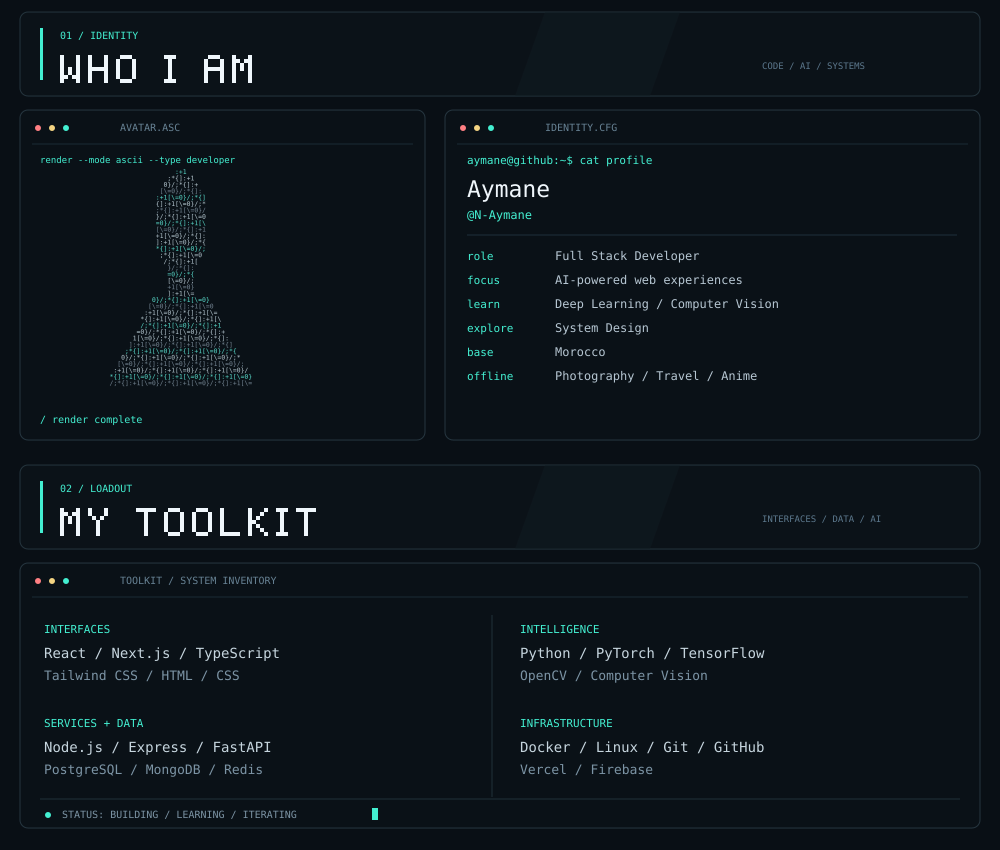

  

  
<strong>Full Stack Developer · AI / ML Enthusiast · Morocco</strong>

  
I build web experiences and explore intelligent systems. From thoughtful interfaces to the models behind them.

  
  

 

<code>[+] OPEN FULL LOADOUT / TEXT MODE</code>

**Behind the code:** Aymane · Morocco · Full stack development & AI. Building AI-powered web apps; exploring deep learning, computer vision and system design. Beyond code: photography, travelling, open source and anime.

**Interface:** React · Next.js · TypeScript · Tailwind CSS · HTML · CSS  
**Backend & data:** Node.js · Express · FastAPI · PostgreSQL · MongoDB · Redis  
**AI & infrastructure:** Python · PyTorch · TensorFlow · OpenCV · Docker · Linux  
**Extended toolkit:** JavaScript · Java · C++ · C · MySQL · Supabase · Prisma · Kubernetes · Nginx · Postman · Git · GitHub · VS Code · Figma · Notion · Vercel · Firebase

---

### 📊 GitHub Analytics

  
  

  

  

---

### 📈 Contribution Stats

  
  
  

---

### 🐍 Contribution Snake

<picture>
  <source media="(prefers-color-scheme: dark)" srcset="https://raw.githubusercontent.com/N-Aymane/N-Aymane/output/github-contribution-grid-snake-dark.svg">
  <source media="(prefers-color-scheme: light)" srcset="https://raw.githubusercontent.com/N-Aymane/N-Aymane/output/github-contribution-grid-snake.svg">
  
</picture>

---

### 👾 Contribution Invaders

  <h3>GitHub Achievements</h3>
  
  
  
  
  

